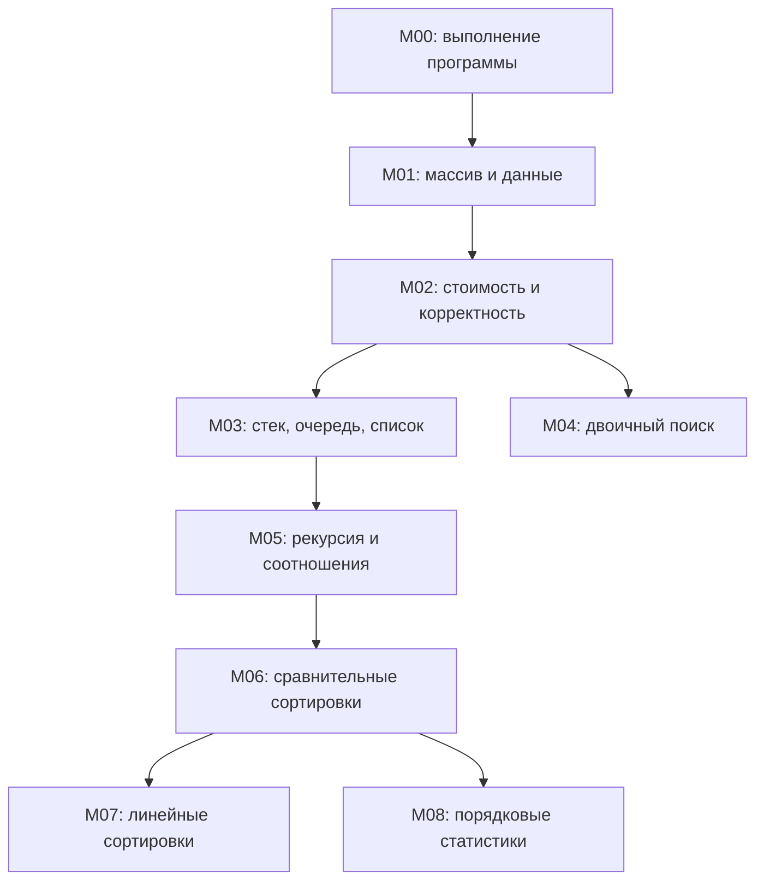
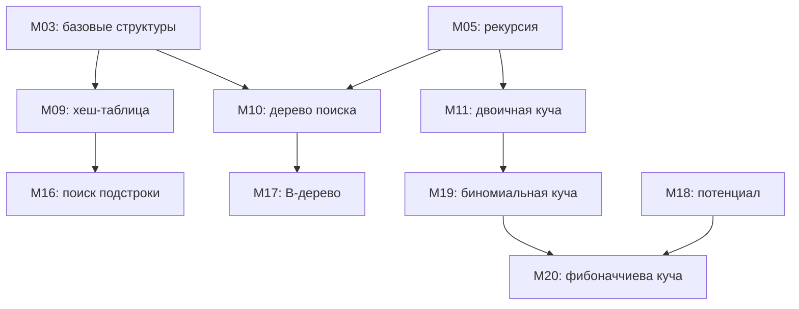
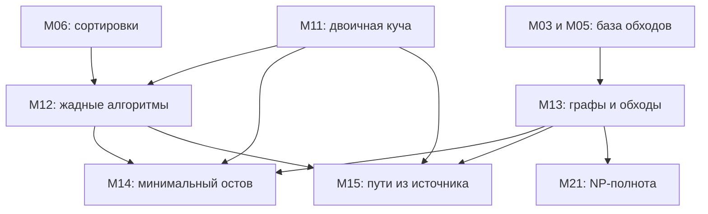

# Зависимости между темами

Стрелка A → B означает, что для самостоятельного разбора B используем понятия из A. Это учебные предпосылки данного маршрута. Их не следует путать с порядком номеров и с математической невозможностью иного объяснения. Например, рекурсию можно объяснить раньше стека, но здесь стек сначала делает вызовы понятнее.

Критерии входа — в файлах тем. Таблица — полная; схемы ниже показывают отдельные связи и не заменяют её.

| Модуль | Требуется перед входом | Оговорка |
| --- | --- | --- |
| M00 | нет | — |
| M01 | M00 | — |
| M02 | M01 | — |
| M03 | M01, M02 | — |
| M04 | M01, M02 | — |
| M05 | M02, M03 | — |
| M06 | M05 | — |
| M07 | M06 | — |
| M08 | M06 | — |
| M09 | M03, M02 | Можно изучать до M04–M08, после базовых структур |
| M10 | M03, M05 | — |
| M11 | M03, M05 | — |
| M12 | M06, M11 | — |
| M13 | M03, M05 | — |
| M14 | M13, M12, M11 | Достаточно минимального DSU внутри модуля; вся глава 21 не нужна |
| M15 | M13, M11, M12 | Полный модуль динамического программирования не требуется |
| M16 | M09, M02 | — |
| M17 | M10 | — |
| M18 | M03, M05 | — |
| M19 | M11, M05, M03 | — |
| M20 | M19, M18 | M15 полезен для мотивации; математической предпосылкой не является |
| M21 | M02, M05, M13 | B-деревья, строки и сложные кучи не требуются |

## Основа, поиск и сортировка

## Структуры и независимые ветки

## Жадность и графы

## Математика по потребности

| Что | Когда вводим | Сколько нужно сейчас |
| --- | --- | --- |
| Индексы, интервалы, остаток от деления | M01, затем кольцевая очередь M03 | Маленькие примеры руками |
| Логарифм и суммы | M02, повтор M05/M11 | Деление пополам, арифметическая и геометрическая суммы |
| Инвариант | M02, повтор M04/M06 | Начало, сохранение, ответ и завершение |
| Индукция | M05 | База и шаг на знакомой задаче |
| Вероятность и ожидание | Перед ожидаемыми оценками M06/M08/M09 | Равновероятный выбор, ожидание, его линейность |
| Множества и отношения порядка | M01, M09/M10 | Принадлежность, включение, ключ, сравнение |
| Потенциал и телескопическая сумма | M18 | Полный разбор простого примера до фибоначчиевой кучи |
| Длина двоичной записи, логические формулы, сводимость | M21 | Примеры до общих утверждений |

Отдельный полный курс математики перед первым занятием не нужен. Если понятие уже понятно, подтверждаем маленькой задачей и идём дальше. Для частичного вводного знакомства допускается разобрать правило стека/очереди до завершения формальной части M02; самостоятельные реализации и оценки проверять после нужной базы.
