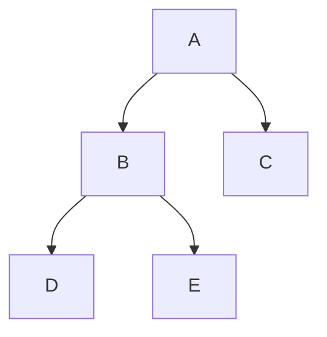

# M03. Стек, очередь и связные списки с нуля

Нужно отменять последние действия, выдавать заявки по порядку или соединять объекты без сдвига массива. Научимся различать эти задачи, выполнять операции руками, менять связи и объяснять стоимость каждого действия.

## Перед началом

Нужны индекс, длина и вместимость из [M01](../M01/README.md), а также смысл инварианта и оценки времени из [M02](../M02/README.md). Владение указателями не предполагается: они вводятся в §4. C++ можно читать после псевдокода.

Короткое воспроизведение: в массиве вместимости 5 находятся `[6, −3]`, длина 2. Какой индекс последнего элемента? Куда записать следующий? Почему удаление первого со сдвигом затрагивает остальные элементы? Если трудно, вернись к §1/§4 M01.

## Как проходить

| Часть | Что прочитать | Один следующий шаг |
| --- | --- | --- |
| Первый подход | §1–2: правило выдачи и стек | M03-P1; затем остановиться |
| Работа с массивом | §3: кольцевая очередь | P2.a и P2.b в разные подходы |
| Связи | §4–5: узел и односвязный список | P3.a; реализация P3.b позже |
| Приложение | §6: скобки | P4 |
| Согласованное продолжение | §7: двусвязность, кольцо и владельцы; §8: дерево | Короткие остановки внутри текста, без нового обязательного листка |

Основной набор — исходные [M03-P1–P4](practice.md), разделённые на небольшие шаги; дополнительных обязательных ID нет. [Помощь](help.md) открывается отдельно. Продолжение §7–8 входит в полный объём темы, но не требуется в первый вечер.

## 1. Сначала правило выдачи

Добавим числа 6 и −3, затем попросим один элемент обратно.

| Правило | Что выдаётся | Что остаётся |
| --- | --- | --- |
| Последним добавлен — первым выдан | −3 | `[6]` |
| Первым добавлен — первым выдан | 6 | `[−3]` |

Первое правило задаёт **стек**: добавляем и снимаем с одного конца, называемого вершиной. Сокращение LIFO означает «последним пришёл — первым вышел». Второе задаёт **очередь**: добавляем в конец, извлекаем из начала. FIFO означает «первым пришёл — первым вышел».

Пока это **интерфейсы**, то есть договорённости о допустимых операциях и результате. **Реализация** определяет, где хранятся элементы и как исполняются команды. Стек можно хранить и в массиве, и в списке. Связный список сам по себе не заставляет выдавать элементы в порядке очереди.

| Назначение | Стек | Очередь | Меняет данные? |
| --- | --- | --- | --- |
| Добавить | `push(x)` | `enqueue(x)` | Да, при успехе |
| Посмотреть следующий выдаваемый | `top()` | `front()` | Нет |
| Извлечь | `pop()` | `dequeue()` | Да, при успехе |
| Узнать пустоту | размер равен 0 | размер равен 0 | Нет |

В ручных трассах извлечение возвращает удалённое значение. В нашем C++ результат разделён: `bool` сообщает успех, а параметр `int& out` получает число. `&` здесь позволяет изменить переменную вызывающего кода. При отказе и структура, и `out` сохраняются. Поэтому ноль и отрицательные числа — обычные данные, не признаки ошибки.

У стандартных адаптеров C++ `std::stack` и `std::queue` метод `pop()` не возвращает удалённое значение: сначала читают `top()` или `front()`, проверив непустоту. Не смешивай этот интерфейс с нашим учебным.

История отмен обычно требует стека; обслуживание заявок в порядке поступления — очереди. Если требуется выбрать заявку с наибольшим приоритетом, одного правила FIFO недостаточно; это будущая M11.

## 2. Стек на заранее выделенном массиве

Пусть вместимость `C = 3`. Добавим 6, −3, 8, затем извлечём элемент. Вершина в таблицах всегда справа.

| Действие | Логический стек | `n` | Результат |
| --- | --- | --- | --- |
| Начало | `[]` | 0 | — |
| `push(6)` | `[6]` | 1 | Успех |
| `push(−3)` | `[6, −3]` | 2 | Успех |
| `push(8)` | `[6, −3, 8]` | 3 | Успех |
| `push(11)` | `[6, −3, 8]` | 3 | Отказ: нет места |
| `top()` | `[6, −3, 8]` | 3 | 8 |
| `pop()` | `[6, −3]` | 2 | 8 |

В `a[0..n)` находятся действующие элементы, `n` — их число. Следующий добавляемый элемент занимает `a[n]`, существующая вершина — `a[n−1]`. Эти позиции различаются на единицу. При `n = 0` вершины нет.

```text
ДОБАВИТЬ_В_СТЕК(x):
    если n = C: вернуть НЕУСПЕХ
    a[n] ← x
    n ← n + 1
    вернуть УСПЕХ

СНЯТЬ_СО_СТЕКА():
    если n = 0: вернуть НЕУСПЕХ без значения
    n ← n − 1
    вернуть УСПЕХ и a[n]
```

Уменьшение `n` не обязано стирать старое число в физической ячейке. Оно перестаёт входить в стек. При следующем добавлении эта ячейка будет перезаписана.

В C++ `struct` объединяет состояние и функции работы с ним. Вызов `s.push(6)` означает «выполнить добавление для стека `s`». `std::array<int, CAPACITY>` — знакомый фиксированный буфер. Полная реализация `Stack`, включая `top`, находится в [structures.cpp](structures.cpp); основные операции выглядят так:

```cpp
bool push(int x) {
    if (n == CAPACITY) return false;
    a[n] = x;
    ++n;
    return true;
}

bool pop(int& out) {
    if (n == 0) return false;
    --n;
    out = a[n];
    return true;
}
```

Это методы внутри `struct Stack`, где уже объявлены `a` и `n`; отдельной законченной программой этот фрагмент не является.

### Почему правило сохраняется

Инвариант: `0 ≤ n ≤ C`, а первые `n` ячеек содержат добавленные, но ещё не снятые элементы в порядке добавления. Пустой стек его выполняет. Успешное добавление приписывает ровно один новый элемент справа, не меняя прежних. Снятие берёт правый край и сокращает последовательность на один, поэтому выдаётся последний оставшийся элемент. Проверки не допускают чтение при пустоте и запись за буфер; отказ сохраняет инвариант. Циклов нет, число действий каждой команды ограничено.

При машинных целых каждое действие требует постоянного числа обращений: `push`, `pop`, `top` имеют **Θ(1) в худшем случае**. Для семейства буферов вместимости `C` хранение требует Θ(C), служебное состояние — Θ(1). Создание показанного буфера с обнулением требует Θ(C); оно не входит в цену каждой следующей команды. В исполнимом примере `C` просто фиксировано равным 3.

### Если массив растёт

При заполнении растущего массива может понадобиться новый буфер и перенос `n` элементов. Тогда отдельное добавление стоит Θ(n). При геометрическом росте добавления имеют амортизированную O(1) стоимость; это гарантия для серии операций, не для каждого вызова и не математическое ожидание. Полное доказательство отложено до M18. Наша реализация память не расширяет и явно отказывает при заполнении.

**Остановка:** что произойдёт с `out`, если снять элемент с пустого стека? Выполни P1, позже — P2.a.

## 3. Очередь и кольцевые индексы

При очереди `[6, −3, 8]` первым должен выйти 6. Если сдвигать −3 и 8 влево после удаления, понадобится `n−1` переносов, то есть Θ(n) работы. Вместо переноса данных переместим границу начала.

### Как замкнуть массив

Позиции массива вместимости 3 идут по кругу: после 0 идёт 1, затем 2, затем снова 0. Остаток от деления даёт этот переход: `(2 + 1) % 3 = 0`. Для неотрицательного `i` выражение `i % C` даёт индекс от 0 до `C−1`. Делитель `C` должен быть положительным.

Храним:

- `head` — индекс первого элемента при непустой очереди;
- `n` — число элементов;
- `a` — буфер вместимости `C`.

Место следующей записи вычисляем как `tail = (head + n) % C`. Сам `tail` отдельно не храним. Когда очередь полна, это только расчётный индекс: писать туда нельзя.

### Полная трасса

В столбце буфера ячейки перечислены в физическом порядке 0, 1, 2. Знак `—` означает отсутствие действующего элемента в этой ячейке; старый битовый образ в памяти может сохраняться. Логический порядок начинается с `head` и может пересечь конец массива.

| Команда | Буфер 0, 1, 2 | `head` | `n` | `tail` | Очередь от начала | Результат |
| --- | --- | --- | --- | --- | --- | --- |
| Начало | `[—, —, —]` | 0 | 0 | 0 | `[]` | — |
| `enqueue(6)` | `[6, —, —]` | 0 | 1 | 1 | `[6]` | Успех |
| `enqueue(−3)` | `[6, −3, —]` | 0 | 2 | 2 | `[6, −3]` | Успех |
| `enqueue(8)` | `[6, −3, 8]` | 0 | 3 | 0 | `[6, −3, 8]` | Успех |
| `enqueue(99)` | `[6, −3, 8]` | 0 | 3 | 0 | `[6, −3, 8]` | Отказ |
| `dequeue()` | `[—, −3, 8]` | 1 | 2 | 0 | `[−3, 8]` | 6 |
| `enqueue(11)` | `[11, −3, 8]` | 1 | 3 | 1 | `[−3, 8, 11]` | Успех |
| `dequeue()` | `[11, —, 8]` | 2 | 2 | 1 | `[8, 11]` | −3 |
| `dequeue()` | `[11, —, —]` | 0 | 1 | 1 | `[11]` | 8 |
| `dequeue()` | `[—, —, —]` | 1 | 0 | 1 | `[]` | 11 |
| `dequeue()` | `[—, —, —]` | 1 | 0 | 1 | `[]` | Отказ |

И в полном, и в пустом состоянии `tail = head`. Проверка только равенства индексов ошибочна. Здесь состояния различает `n`: пусто при `n = 0`, полно при `n = C`. Все три ячейки разрешено использовать.

```text
ДОБАВИТЬ_В_ОЧЕРЕДЬ(x):
    если n = C: вернуть НЕУСПЕХ
    a[(head + n) mod C] ← x
    n ← n + 1
    вернуть УСПЕХ

ИЗВЛЕЧЬ_ИЗ_ОЧЕРЕДИ():
    если n = 0: вернуть НЕУСПЕХ без значения
    x ← a[head]
    head ← (head + 1) mod C
    n ← n − 1
    вернуть УСПЕХ и x
```

```cpp
bool enqueue(int x) {
    if (n == CAPACITY) return false;
    a[(head + n) % CAPACITY] = x;
    ++n;
    return true;
}

bool dequeue(int& out) {
    if (n == 0) return false;
    out = a[head];
    head = (head + 1) % CAPACITY;
    --n;
    return true;
}
```

Фрагмент находится внутри `struct Queue` с состоянием `a`, `head`, `n`. `front` читает `a[head]` только после проверки непустоты и не меняет очередь.

### Обоснование порядка и границ

Инвариант: `0 ≤ n ≤ C`, `0 ≤ head < C`; логический элемент с номером `k`, где `0 ≤ k < n`, хранится в `a[(head+k) % C]`. Эти индексы различны, поскольку участок длины не больше `C` проходит каждую позицию круга не более одного раза.

При добавлении `n < C`, поэтому индекс для `k = n` ещё свободен. Прежние элементы не меняются, новый становится последним. При удалении сохраняем первый; для нового элемента с номером `k` адрес равен старому адресу элемента `k+1`. Следовательно, порядок остальных не меняется. После удаления единственного элемента получается `n = 0`; `head` остаётся допустимым, его необязательно сбрасывать в ноль. При отказе ничего не меняется. Каждая команда конечна: циклов нет.

Команды, включая проверки отказа, требуют Θ(1) в худшем случае: вместо `n−1` переносов выполняется одно изменение границы. Хранение — Θ(C), служебная память — Θ(1), подготовка обнулённого массива — Θ(C). Выражения индексов должны помещаться в тип: при `C = 3` сумма `head+n` не больше 5, переполнения `int` нет. Для огромного произвольного `C` этот вопрос потребовал бы отдельного выбора типа.

**Остановка:** почему при непустой очереди `[−3, 8, 11]` физическое чтение `a[0], a[1], a[2]` даст другой порядок? Перейди к P2.b после собственной реализации стека.

## 4. Узел, адрес и изменение связи

Представим, что три записи лежат в разных местах памяти:

| Имя узла | Значение | `next`, ссылка на следующий |
| --- | --- | --- |
| A | 9 | B |
| B | 5 | C |
| C | 8 | Нет узла |

Переменная `head` указывает на A. Обход из A по `next` даёт значения 9, 5, 8, хотя записи не обязаны занимать соседние адреса. Это **односвязный список**.

Узел хранит значение и связь. **Адрес** позволяет указать на конкретный объект; **указатель** — переменная, которая хранит такой адрес. В рисунке используем имена A/B/C вместо числовых адресов. Два узла могут содержать одинаковые числа, оставаясь разными объектами. **`nullptr`** — специальное значение указателя «нет объекта», а не узел со значением 0.

```cpp
struct Node {
    int value;
    Node* next;
};
```

`Node*` читается «указатель на узел». Если `p` указывает на живой узел, `p->value` читает его число, `p->next` — его связь. Обращаться через `nullptr` нельзя. Присваивание `p = p->next` передвигает наш указатель, сохраняя связи списка; присваивание `p->next = q` меняет саму цепочку.

### Дойти до нужного узла

Для поиска значения 8 начнём с `p = head`: проверим A, затем B, затем C. Для отсутствующего значения после C получится `nullptr`. По известному индексу 2 тоже нужны два перехода: формула адреса, как у массива, здесь не работает.

```text
НАЙТИ(x):
    p ← head
    пока p не НЕТ_УЗЛА и значение(p) ≠ x:
        p ← следующий(p)
    вернуть p
```

```cpp
Node* find(int x) const {
    Node* p = head;
    while (p != nullptr && p->value != x) p = p->next;
    return p;
}
```

Это метод списка. `const` после параметров означает, что сам метод не меняет поля объекта списка. Возвращённый указатель используется как временная ссылка на узел, не передаёт владение им. `&&` проверяет вторую часть только при истинности первой, поэтому `p->value` не читается при `p == nullptr`.

Инвариант обхода: ни один уже пройденный узел не содержит `x`, а `p` указывает на первый ещё не проверенный узел или равен `nullptr`. Первый найденный узел даёт первое вхождение; `nullptr` после конца подтверждает отсутствие. В конечной цепочке без циклов на каждом шаге остаётся на один узел меньше. На `n` узлах худшее время Θ(n+1), дополнительная память Θ(1). Запись `+1` учитывает пустой список.

### Создать и освободить объект

`new Node{x, old_next}` создаёт узел, записывает поля в порядке объявления и возвращает указатель. Созданный объект продолжает жить после выхода из функции. `delete victim` уничтожает один ранее созданный через `new` узел и освобождает его память. Оно не удаляет всю цепочку по `next` и не исправляет чужие указатели автоматически.

**Владелец** отвечает за освобождение узлов. В нашем `SinglyList` владелец один — объект списка; временные указатели только помогают найти и связать узлы. После удаления узла его старые указатели становятся непригодны для обращения, даже если переменная ещё хранит прежний адрес. Вставка или удаление другого узла не перемещает оставшиеся узлы. Обычный `new` при нехватке памяти выбрасывает исключение; в учебных трассах предполагаем успешное выделение, исключения не изучаем.

## 5. Односвязный список: сохраняем оставшуюся цепочку

### Вставка в начало и после известного узла

Чтобы перед 9, 5, 8 поставить 6, создадим U со значением 6, свяжем `U.next = A`, затем сделаем `head = U`. Порядок прежних узлов сохраняется. На пустом списке старая голова равна `nullptr`: тот же приём создаёт единственный узел.

Чтобы вставить −2 **после уже известного B**, сначала сохраним путь к C в новом узле:

| Шаг | `B.next` | `U.next` | Обход от головы |
| --- | --- | --- | --- |
| Исходная цепочка | C | U ещё нет | 9, 5, 8 |
| Создать U со значением −2 и связью на C | C | C | 9, 5, 8 |
| Связать B с U | U | C | 9, 5, −2, 8 |

```text
ВСТАВИТЬ_ПОСЛЕ(p, x):
    если p = НЕТ_УЗЛА: вернуть НЕУСПЕХ
    u ← новый узел со значением x и связью следующий(p)
    следующий(p) ← u
    вернуть УСПЕХ
```

```cpp
bool insert_after(Node* p, int x) {
    if (p == nullptr) return false;
    Node* u = new Node{x, p->next};
    p->next = u;
    return true;
}
```

Предусловие: непустой `p` указывает на живой узел **этого** списка. Функция не проверяет принадлежность обходом, иначе не могла бы обещать постоянное число изменений. Чужие и уже освобождённые указатели передавать нельзя. Вставка после последнего также работает: новый узел получает `next = nullptr`.

Если сначала заменить `B.next`, а потом пытаться взять из него прежнюю связь, можно получить `U.next = U` и потерять C. Правильный порядок сначала связывает новый узел с прежним продолжением, затем меняет единственную входящую связь.

### Удаление после предшественника

Вернёмся к исходному списку 9, 5, 8. Удалим C, зная B. Затем отдельно покажем удаление головы.

| Действие | Изменение связи | Живые данные от головы |
| --- | --- | --- |
| Запомнить `victim = B.next` | Связи прежние | 9, 5, 8 |
| `B.next = victim.next` | `B.next = nullptr` | 9, 5 |
| Освободить C | C больше не существует | 9, 5 |
| Удалить голову A | `head = B`, освободить A | 5 |
| Удалить единственный B | `head = nullptr`, освободить B | Пусто |

```text
УДАЛИТЬ_ПОСЛЕ(p):
    если p = НЕТ_УЗЛА или следующий(p) = НЕТ_УЗЛА:
        вернуть НЕУСПЕХ
    victim ← следующий(p)
    следующий(p) ← следующий(victim)
    освободить victim
    вернуть УСПЕХ

УДАЛИТЬ_ПЕРВЫЙ():
    если head = НЕТ_УЗЛА: вернуть НЕУСПЕХ без значения
    victim ← head
    x ← значение(victim)
    head ← следующий(victim)
    освободить victim
    вернуть УСПЕХ и x
```

C++-реализации `erase_after`, `pop_front` и всей структуры приведены в [исполнимом файле](structures.cpp). Сначала читается продолжение, затем освобождается объект. Обратный порядок пытается читать уже уничтоженный узел.

Инвариант списка: от `head` достижима конечная цепочка различных живых узлов, последний связан с `nullptr`; владелец отвечает за каждый из этих узлов. Вставка заменяет одну связь на две через новый узел, сохраняя все прежние. Удаление заменяет две последовательные связи одной и освобождает ровно исключённый узел. Остальные пути и порядок сохраняются. В случае головы меняется внешний указатель `head`. Отсюда следуют корректность и отсутствие потери оставшейся цепочки. Эти операции не содержат циклов и заканчиваются за ограниченное число действий.

### Что именно стоит постоянное время

Вставка после известного узла, удаление после известного предшественника и удаление головы требуют Θ(1) **изменений связей** и Θ(1) вспомогательной памяти. В стандартной модели учебных структур добавляем условие: выделение/освобождение одного узла фиксированного размера считается O(1). Стандарт C++ не обещает такую временную границу для любого распределителя.

Найти по значению нужный узел или предшественника в худшем случае стоит Θ(n+1). Вставка по индексу `i` требует сначала пройти `i` связей; само изменение после этого короткое. Для удаления последнего нужен его предшественник. Даже отдельно сохранённый `tail` не даёт обратной ссылки в односвязном списке, поэтому поиск предшественника остаётся линейным. В нашей минимальной реализации хранится только `head`.

Очередь можно построить на односвязном списке с `head` и `tail`: приписывать к `tail`, извлекать `head`. При вставке в пустой список обновляются оба; после удаления единственного оба становятся `nullptr`. Тогда оба изменения занимают O(1) в оговорённой модели. Вставка в конец списка с одной лишь головой требует обхода.

### Очистка и единственный владелец

```text
ОЧИСТИТЬ():
    пока head не НЕТ_УЗЛА:
        victim ← head
        head ← следующий(victim)
        освободить victim
```

За шаг удаляется один узел, оставшаяся цепочка сохраняется; поэтому после `n` шагов список пуст, каждый узел освобождён один раз. Время Θ(n+1), вспомогательная память Θ(1), рекурсии нет. Память самого списка из `n` узлов — Θ(n).

В `structures.cpp` функция `clear()` вызывается также деструктором `~SinglyList()` при завершении жизни объекта. Строки с `= delete` запрещают копировать владельца: поверхностная копия дала бы двум спискам одни и те же узлы и привела бы к повторному освобождению. `= default` оставляет обычное создание пустого списка. Для этой темы достаточно пользоваться одним объектом списка и не копировать его; полный курс управления ресурсами не требуется.

**Остановка:** если известен только удаляемый C, достаточно ли этого для Θ(1)-удаления из односвязного списка? Сделай сначала рисунки P3.a; P3.b — отдельная небольшая реализация.

## 6. Приложение стека: скобки

Рассмотрим `[()()]`. При открывающей скобке нужно запомнить незавершённую пару. Закрывающая должна соответствовать **последней** ещё не закрытой открывающей.

| Прочитан символ | Стек открывающих, вершина справа | Действие |
| --- | --- | --- |
| Начало | Пуст | — |
| `[` | `[` | Добавить |
| `(` | `[ (` | Добавить |
| `)` | `[` | Снять `(` |
| `(` | `[ (` | Добавить |
| `)` | `[` | Снять `(` |
| `]` | Пуст | Снять `[` |

Очередь здесь ошибётся уже на `[()]`: первая закрывающая `)` относится к последней `(`, а первой в очередь вошла `[`. Одного общего счётчика недостаточно: `([)]` содержит поровну открывающих и закрывающих, но пары пересекаются.

Допустимый вход — строка длины `m` от 0 до 200 000, содержащая только `(`, `)`, `[`, `]`. Результат — верно ли, что все скобки образуют правильно вложенные пары одного вида. Пустая строка корректна.

```text
ПРОВЕРИТЬ(s):
    создать пустой стек
    для каждого символа c слева направо:
        если c открывающий: добавить c в стек
        иначе:
            если стек пуст: вернуть НЕТ
            если вершина не образует пару с c: вернуть НЕТ
            снять вершину
    вернуть ДА тогда и только тогда, когда стек пуст
```

Инвариант: если ошибка ещё не обнаружена, стек содержит ровно не закрытые открывающие скобки прочитанной части, в порядке их появления. Открытие добавляет одну; закрытие снимает именно требуемую последнюю. Пустота при закрытии означает отсутствие пары слева, неверный вид вершины — нарушение вложенности. После всей строки непустой стек означает незавершённые пары. Если он пуст и ошибок не было, каждая пара правильно закрыта. На шаге потребляется один символ, не более `m` шагов; ранний отказ тоже заканчивает выполнение.

В разборе P4 дан C++17-код `brackets_ok`. Используем `std::vector<char>` как стек с `push_back`, `back`, `pop_back`, `empty`; вместимость 3 из P2 для этой задачи недостаточна. Сначала `reserve(s.size())` обеспечивает место для не более чем `m` скобок, не создавая действующих элементов. Внутри прохода перераспределений памяти не будет. Строка передаётся как `const std::string&` без копирования.

Проход занимает O(m+1), в худшем случае Θ(m+1); дополнительная память — O(m+1). Включаем заранее запрошенный буфер: даже если ошибка обнаружена на первом символе, программа уже запросила место для `m` символов. При линейной цене выделения буфера подготовка также O(m+1), итоговая верхняя граница не меняется. Оценки не являются измерением времени работы распределителя памяти.

**Остановка:** какие три разные причины отказа возможны? Теперь можно решать P4; готовые диагностические строки для собственного ответа придумай сам.

## 7. Продолжение: два направления и кольцо

### Двусвязный список

Добавим каждому узлу поле `prev` — связь на предыдущий. В цепочке A, B, C выполняются `A.next = B`, `B.prev = A`, `B.next = C`, `C.prev = B`. У линейного списка голова имеет `prev = nullptr`, последний — `next = nullptr`.

Если B уже известен, его можно исключить без поиска предшественника: `A.next = C`, затем `C.prev = A`. При удалении головы надо изменить `head`, при удалении последнего — `tail`, при удалении единственного — оба. Перед обращением к отсутствующему соседу нужна проверка. После удаления сохраняется правило: для каждой соседней пары прямой и обратный переход согласованы.

### Кольцевой список и условие остановки

В односвязном кольце A, B, C последняя связь `C.next = A`; у единственного узла `A.next = A`. Пустое кольцо без служебного узла обозначим `head = nullptr`. Обход непустого правильного кольца: обработать голову, перейти по `next`, повторять до первого возвращения к голове. Проверка «пока не `nullptr`» здесь никогда не завершится.

```text
если head не НЕТ_УЗЛА:
    p ← head
    повторять:
        обработать p
        p ← следующий(p)
    пока p ≠ head
```

Предусловие — конечное кольцо, все узлы которого принадлежат одному циклу от головы. За `n` переходов вернёмся к голове, каждый узел обработан один раз: Θ(n+1) времени, Θ(1) дополнительной памяти. Произвольный повреждённый граф связей этим алгоритмом не проверяется. Для удаления головы такого кольца надо перенаправить связь последнего на новую голову; известная голова сама по себе не даёт этот последний узел.

### Двусвязное кольцо со служебным узлом

Удобно создать отдельный **сторожевой узел** S. Он обозначает границу, не содержит элемента пользовательской последовательности и никогда не удаляется операцией удаления данных. Пустое состояние: `S.next = S`, `S.prev = S`. Для одного элемента A: `S.next = A`, `S.prev = A`, `A.prev = S`, `A.next = S`. Нулевое значение служебного поля не ищется как пользовательский элемент.

Вставим U перед известным B в кольце с данными A, B, C:

| Запись | Что установлено |
| --- | --- |
| `U.prev = B.prev` | U запоминает A |
| `U.next = B` | U запоминает правого соседа |
| `B.prev.next = U` | A теперь ведёт на U |
| `B.prev = U` | B теперь возвращается к U |

До последних двух записей старая пара A/B ещё цела. После них обе стороны пары заменены на A/U/B. Другие связи не затронуты. При вставке перед S получаем добавление в конец. Для пустого кольца левый сосед B = S тоже S, и те же четыре записи создают единственный элемент.

```text
ВСТАВИТЬ_ПЕРЕД(w, u):
    // w — известный узел кольца или сторож; u — отдельный живой узел
    u.prev ← w.prev
    u.next ← w
    w.prev.next ← u
    w.prev ← u

ОТЦЕПИТЬ(u):
    // u — известный узел данных в кольце, не сторож
    u.prev.next ← u.next
    u.next.prev ← u.prev
    u.prev ← НЕТ_УЗЛА
    u.next ← НЕТ_УЗЛА
```

Удаление U восстанавливает A/B в двух направлениях. При единственном элементе обе изменяемые связи принадлежат S, и S снова указывает на себя. Инвариант кольца — согласованность соседних `next`/`prev` и возвращение к S после всех узлов данных. Описанные замены сохраняют его; команды имеют постоянное число записей и заканчиваются без обхода. Поиск узла по значению по-прежнему O(n+1), отцепление известного — Θ(1).

В `structures.cpp` показаны `DNode`, `init_ring`, `insert_before`, `unlink_node`. Узлы этого отдельного примера созданы как обычные локальные переменные; их память освобождается при выходе из области видимости. `&u` в вызове получает адрес существующего узла. **Отцепить** его означает изменить связи, а не вызвать `delete`. Эти локальные объекты нельзя передавать владельцу `SinglyList`, освобождающему узлы через `delete`. Для варианта с `new` владелец после отцепления отдельно освободил бы узел. Вызов `unlink_node` для сторожа, чужого или уже отцепленного узла нарушает предусловие.

Проход по данным: начать с `S.next`, пока текущий узел не S, обрабатывать его и переходить по `next`. Для пустоты нет ни одного шага, для `n` элементов — `n` шагов. Здесь критерием конца служит S, а не `nullptr`.

**Остановка:** восстанови четыре связи пустого и одноэлементного кольца. Какие две записи вернут пустоту после отцепления единственного узла? Отдельную реализацию второго списка сейчас сдавать не нужно.

## 8. Продолжение: от списка к корневому дереву

У папки A есть подпапки B и C; у B — D и E. Это **корневое дерево**: A — корень, B/C — его дети, A — их родитель, D/E — дети B и братья между собой. Узлы без детей — листья. У каждого некорневого узла один родитель; по связям к детям нет циклов.



Детей можно хранить списком: `first_child` указывает на первого ребёнка, `next_sibling` каждого ребёнка — на следующего брата. При фиксированном порядке B перед C, D перед E получим:

| Узел | `parent` | `first_child` | `next_sibling` |
| --- | --- | --- | --- |
| A | Нет | B | Нет |
| B | A | D | C |
| C | A | Нет | Нет |
| D | B | Нет | E |
| E | B | Нет | Нет |

Чтобы перечислить детей B, берём D, затем его брата E, затем конец. Переход от B к C ведёт к брату, а не к ребёнку. Число ссылок из узла фиксировано, число детей может быть любым. У одиночного корня все три поля пусты; пустое дерево имеет пустую ссылку на корень.

```text
c ← v.first_child
пока c не НЕТ_УЗЛА:
    обработать c
    c ← c.next_sibling
```

Список конечен: каждый шаг переходит к следующему ребёнку; перечисление `d` детей требует Θ(d+1) времени, Θ(1) дополнительной памяти. Таблица восстанавливает дерево однозначно: у каждого родителя берём цепочку детей, сохраняя их порядок. Три поля на узел дают Θ(n) хранения для `n` узлов. Балансировка, рекурсивные обходы и освобождение целого дерева будут изучаться позже.

**Остановка:** перечисли детей A и B по таблице. Объясни, почему C не становится ребёнком B из-за ссылки `B.next_sibling`.

## 9. Как выбрать реализацию

Считаем машинные значения и ссылки постоянного размера. `n` — число элементов, `C` — вместимость; у списка отдельно оговорена модель выделения одного узла.

| Реализация | Выгодная операция | Условие и цена | Что остаётся дорогим |
| --- | --- | --- | --- |
| Стек на фиксированном массиве | Добавить/снять вершину | Θ(1) в худшем случае, при полноте отказ | Произвольный поиск Θ(n+1) |
| Стек на растущем массиве | Добавить в конец | Амортизированно O(1); перенос может стоить Θ(n) | Нельзя обещать Θ(1) каждому добавлению |
| Кольцевая очередь | Добавить в конец/снять начало | Θ(1) в худшем случае при фиксированной вместимости | Найти произвольное значение Θ(n+1) |
| Односвязный список | Вставить/удалить после предшественника | Θ(1), если предшественник уже известен | Найти его, добраться до произвольного индекса — O(n+1) |
| Двусвязный список | Отцепить узел | Θ(1), если сам узел уже известен | Поиск по значению O(n+1); нужны две связи на узел |

Списки избегают сдвигов при изменении известных связей, но тратят память на ссылки. Массив даёт прямой доступ по индексу. Выбор зависит от запросов, а не от общего лозунга «список быстрее массива».

## Что теперь должно получаться

- Проследить стек и очередь на одной последовательности команд.
- Различить пустую и полную кольцевую очередь, объяснить переход через конец.
- Безопасно сохранить продолжение списка перед изменением связи и освобождением узла.
- Отделить поиск узла от изменения известной связи и назвать условия оценки.
- Обосновать проверку скобок, прочитать двусвязное кольцо и таблицу дерева.

Это критерии самопроверки, а не запись о подтверждённых знаниях.

## Код и запуск

Полная демонстрация — [structures.cpp](structures.cpp), C++17. Из корня репозитория:

```bash
g++ -std=c++17 -Wall -Wextra -Wpedantic learn/topics/M03/structures.cpp -o /tmp/m03
/tmp/m03
```

Она не требует ввода; выводит:

```text
stack: -3
queue: -3 8 11
list: 9 8
ring empty: 1
brackets: 1
```

Для самостоятельных реализаций из практики используй собственные данные и проверки. Файл содержит учебные контракты, не проверяет принадлежность произвольного указателя структуре и не предоставляет универсальную библиотеку контейнеров.

## Источники и дальнейшее чтение

Фактически прочитаны следующие фрагменты 21 октября 2026 года. Коды раскрыты в [каталоге](../../sources/README.md).

| Часть | Первичный текст и точный фрагмент | Что использовано |
| --- | --- | --- |
| §1, §4, §7 | S01, М. А. Кузнецов, [лекция 8, версия d1924c4](https://gitlab.maxvas.ru/learning-zone/courses/algorithms/-/blob/d1924c4e3354eb77d88924032288aaaa1a35ee20/lecture_8/lecture_8.md): «Связный список», «Стек», «Очередь» | Термины, варианты списков, интерфейсы; текст получен через публичный API. Сортировки и игровые задачи этой лекции не входят в M03 |
| §2 | S08, Pat Morin, Open Data Structures, C++ online beta, [§2.1 ArrayStack](https://opendatastructures.org/ods-cpp/2_1_Fast_Stack_Operations_U.html): The Basics, Growing and Shrinking, Summary | Размер и буфер, специализация операций для конца; различение единичной и амортизированной оценки |
| §3 | S08, [§2.3 ArrayQueue](https://opendatastructures.org/ods-cpp/2_3_Array_Based_Queue.html), включая Summary | Индекс начала, длина и остаток от деления. Наш фиксированный буфер отказывает вместо расширения |
| §4–5 | S08, [§3.1 SLList](https://opendatastructures.org/ods-cpp/3_1_Singly_Linked_List.html), включая Queue Operations/Summary | Связи, изменение головы, случай единственного узла и цена предшественника |
| §7 | S08, [§3.2 DLList](https://opendatastructures.org/ods-cpp/3_2_Doubly_Linked_List.html), включая Adding and Removing/Summary | Сторожевой узел и двусторонние изменения известных связей |
| §8 | S17, Alen Lovrencic, Paul E. Black, NIST DADS, [Binary tree representation of trees](https://xlinux.nist.gov/dads/HTML/binaryTreeRepofTree.html), редакция 20.11.2008 | Определение «первый ребёнок — следующий брат» и его соответствие исходному дереву |
| C++ в §4–7 | S15, рабочий проект: [expr.ref](https://eel.is/c++draft/expr.ref), [expr.new](https://eel.is/c++draft/expr.new), [expr.delete](https://eel.is/c++draft/expr.delete), [vector.capacity](https://eel.is/c++draft/vector.capacity), [vector.modifiers](https://eel.is/c++draft/vector.modifiers); объявления [stack.defn](https://eel.is/c++draft/stack.defn) и [queue.defn](https://eel.is/c++draft/queue.defn) | Обращение через указатель, создание/освобождение одного объекта, резервирование и операции конца `vector`; использованы положения о соответствующих операциях, не весь стандарт |

Содержание главы 10 S02 служит ориентиром программы, но её полный текст в этой сессии недоступен. Содержательная замена для структур — S01/S08, для представления дерева — S17. Утверждения не выдаются за сверенные с непрочитанной главой. Современный рабочий проект S15 не называется изданием ISO C++17; исполнимые средства отдельно проверяются в режиме C++17.

Объяснения, числа, таблицы и доказательства здесь авторские. Для конкретного затруднения достаточно одного фрагмента: при непонятном переходе индекса открой §2.3 S08, при потере связи — §3.1; читать все источники сразу не требуется.

[Практика](practice.md) · [Подсказки и разборы](help.md) · [Паспорт M03](outline.md) · [Каталог материалов](../../README.md)
